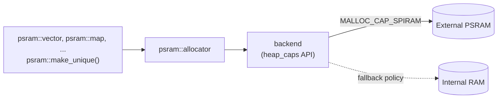

# esp32-psram-allocator

[](https://github.com/PATEmbedded/esp32-psram-allocator/actions/workflows/ci.yml)
[](LICENSE)

C++17 allocators that put standard containers and objects into the external PSRAM of ESP32 chips. Large buffers, tables and maps move out of the few hundred kilobytes of internal RAM that Wi-Fi, Bluetooth and FreeRTOS also need.

```cpp
#include <esp32_psram_allocator.h>

psram::vector<uint16_t> frame(320 * 240);        // 150 KB frame buffer in PSRAM
psram::map<int, psram::string> sensors;          // every node and every string in PSRAM
auto model = psram::make_unique<Model>();        // a single object in PSRAM
psram::fallback::vector<int16_t> samples(8000);  // PSRAM first, internal RAM if PSRAM is full
```

## Why

With `CONFIG_SPIRAM_USE_MALLOC`, ESP-IDF still serves every request smaller than `CONFIG_SPIRAM_MALLOC_ALWAYSINTERNAL` (16 KB by default) from internal RAM. A `std::map` or `std::list` allocates one small node per element, so even a large container ends up in internal RAM while megabytes of PSRAM stay unused. The allocators in this library send every allocation of a chosen container to PSRAM, whatever its size, and leave the rest of the program alone.

## Features

- `psram::allocator<T>`: a stateless standard allocator. All instances compare equal, so containers move and swap as usual.
- Aliases for the standard containers: `vector`, `deque`, `list`, `forward_list`, `map`, `multimap`, `set`, `multiset`, `unordered_map`, `unordered_set` and `string`.
- Two policies: PSRAM only (`psram::`) or PSRAM first with internal RAM as fallback (`psram::fallback::`).
- `psram::make_unique<T>()` for single objects.
- `std::pmr` resources `psram::external_resource()` and `psram::fallback_resource()` (GCC 9 or newer).
- Correct alignment for over-aligned types.
- Works with exceptions (throws `std::bad_alloc`) and without them (aborts, like the standard library).
- Header-only. Usable as an ESP-IDF component, a PlatformIO library and an Arduino library.

## How it works



The allocator asks the heap for memory with the `MALLOC_CAP_SPIRAM` capability. Over-aligned types use `heap_caps_aligned_alloc()`. With the fallback policy a failed request is retried in internal RAM.

## Installation

**PlatformIO**

```ini
lib_deps = https://github.com/PATEmbedded/esp32-psram-allocator.git#v1.0.0
build_unflags = -std=gnu++11   ; only needed with Arduino-ESP32 2.x
build_flags = -std=gnu++17 -DBOARD_HAS_PSRAM
```

**ESP-IDF**: add the repository as a component, for example as a submodule, and enable `CONFIG_SPIRAM` in menuconfig:

```sh
git submodule add https://github.com/PATEmbedded/esp32-psram-allocator.git components/esp32-psram-allocator
```

**Arduino IDE**: install the repository as a ZIP library. It needs Arduino-ESP32 3.x, which compiles with C++17 or newer, and PSRAM enabled in the *Tools* menu.

## Usage

Containers take the same arguments as their standard counterparts:

```cpp
psram::vector<float> spectrum(4096);
psram::unordered_map<psram::string, int> counters;  // psram::string keys work without a custom hash
```

The fallback policy keeps code working on boards without PSRAM:

```cpp
psram::fallback::vector<uint8_t> buffer(64 * 1024);
```

Single objects:

```cpp
struct Model {
    std::array<int8_t, 120 * 1024> weights;
};
auto model = psram::make_unique<Model>();
```

A `psram::unique_ptr<T>` does not convert to a pointer to a base class, because the memory has to be freed at the address it was allocated at.

Polymorphic allocators (needs `<memory_resource>`, for example ESP-IDF 5.x):

```cpp
#include <psram/memory_resource.hpp>

std::pmr::vector<int> values{psram::external_resource()};
```

Checking the PSRAM:

```cpp
if (!psram::available()) {
    // no PSRAM on this module, or CONFIG_SPIRAM is off
}
size_t free = psram::free_bytes();
size_t largest = psram::largest_free_block();
```

## Things to know about PSRAM

- PSRAM is reached through the flash cache. It is slower than internal RAM, especially for random access, so keep small, frequently used data in internal RAM.
- Code that runs while the cache is disabled, such as ISRs placed in IRAM or code that runs during flash writes, must not touch PSRAM.
- On the original ESP32, DMA cannot read or write PSRAM. Allocate DMA buffers with `MALLOC_CAP_DMA` in internal RAM.
- Boards with an ESP32 revision 1 chip need `-mfix-esp32-psram-cache-issue`.

## Requirements

- ESP-IDF 4.4 or newer, or Arduino-ESP32 2.0 or newer
- C++17
- An ESP32-series chip with PSRAM, for example ESP32, ESP32-S2 or ESP32-S3

## Tests

The unit tests run on a PC against a simulated heap that records which region served each request. They cover placement, fallback, alignment, exception safety and leaks, and run with AddressSanitizer and UBSan. CI also builds the examples with ESP-IDF 5.5 and 6.0 for ESP32 and ESP32-S3, and with PlatformIO for Arduino.

```sh
cmake -S . -B build -DPSRAM_ALLOCATOR_SANITIZE=ON
cmake --build build
ctest --test-dir build --output-on-failure
```

## License

MIT. See [LICENSE](LICENSE).
